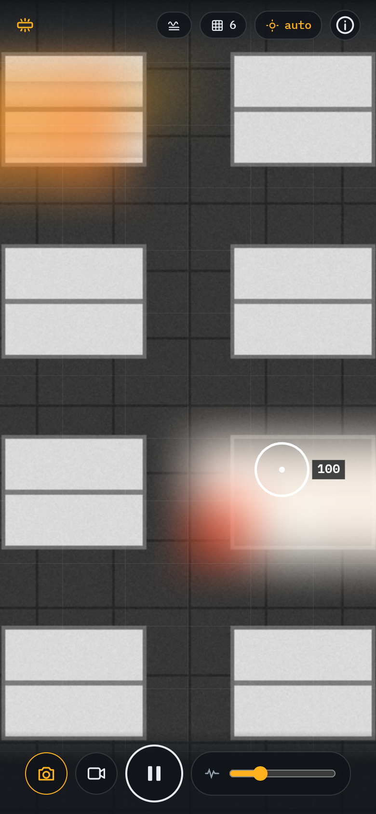

# Flicker Finder

Find the flickering fluorescent fixture with your phone camera.

**Open:** https://coolnamesalltaken.github.io/flicker-finder/

Point the phone at the ceiling with several fixtures in view. The flickering one glows on a heatmap. Tap a spot for its brightness trace, score and frequency.

- Slow flicker (1–15 Hz dropouts, strobing): frame-to-frame brightness per grid cell.
- 120 Hz flicker: rolling-shutter stripes. Needs a short exposure, which Android Chrome can lock (the chip shows 1/N). iOS Safari stays on auto.

Recorded clips work too (clip button), mainly for slow flicker.

## Tests

`test/unit.py` runs the analyzer on synthetic frames in headless Chromium. `test/make_y4m.py` + `test/fakecam.py` run the page against a fake camera.
